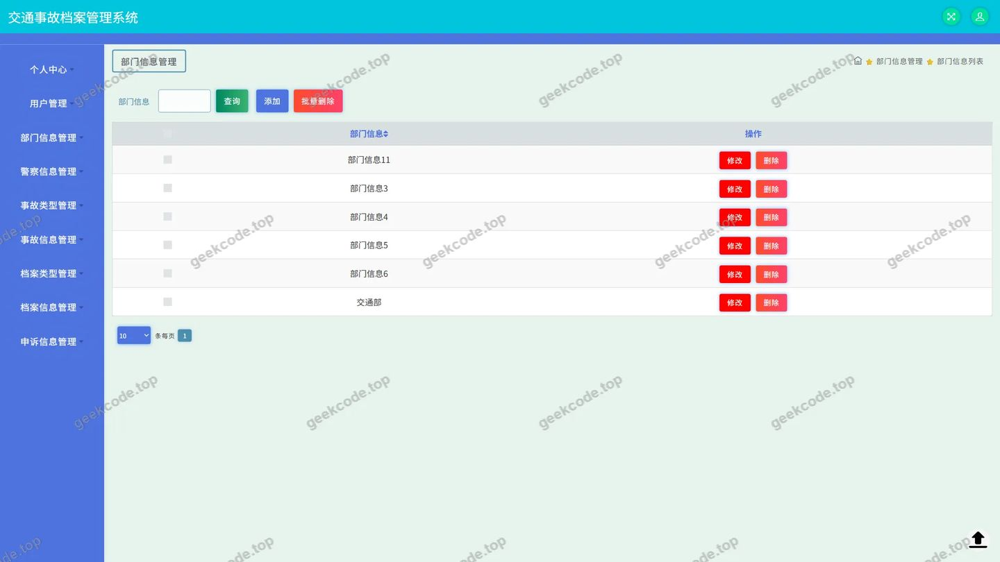
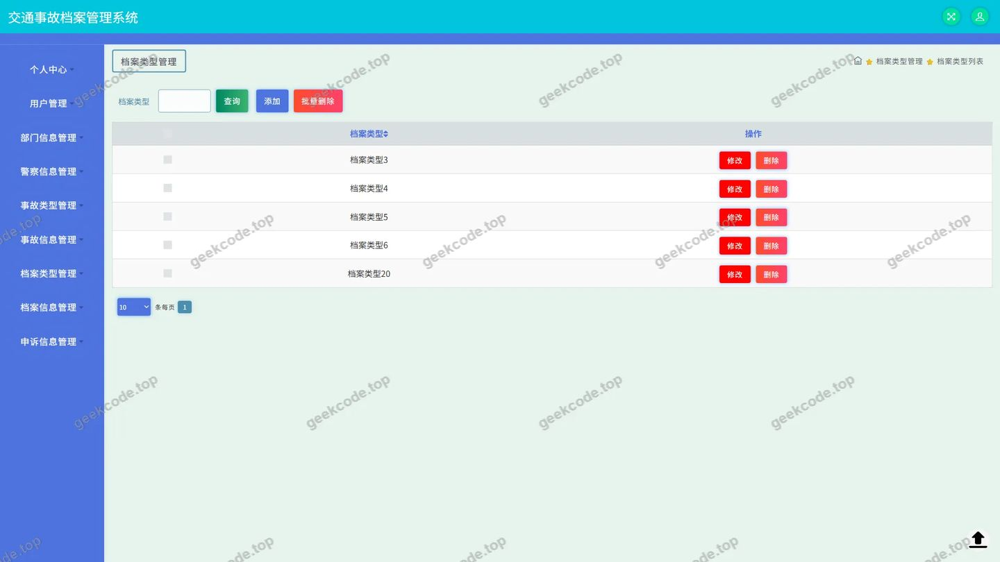
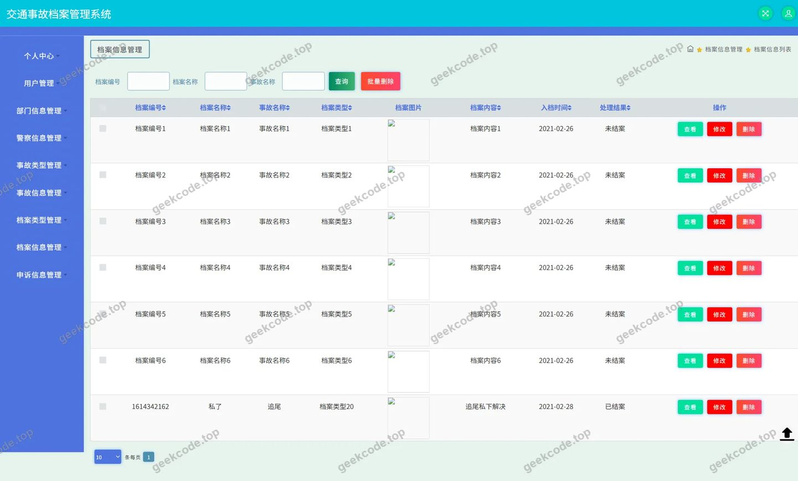
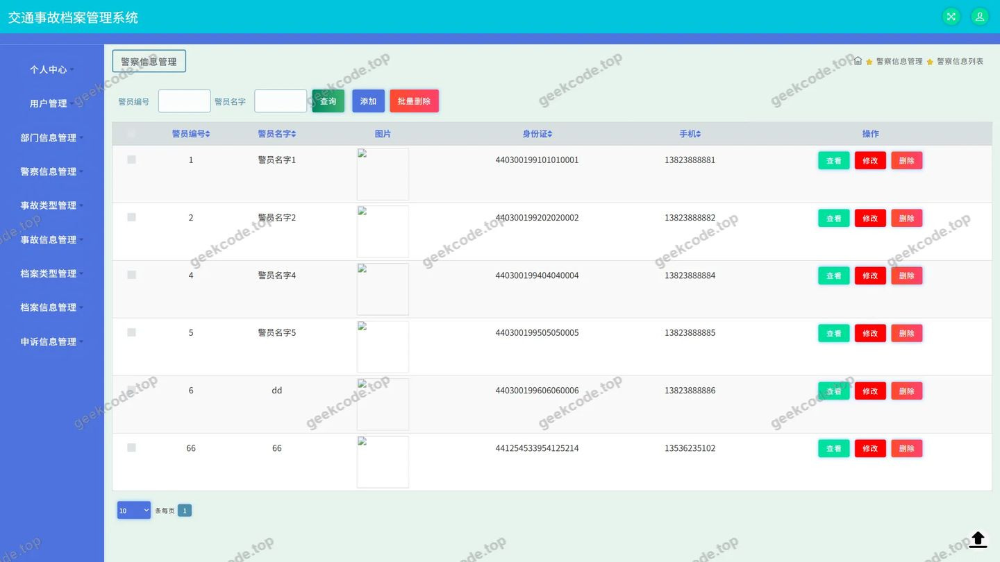
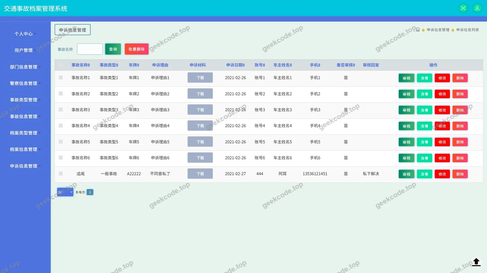
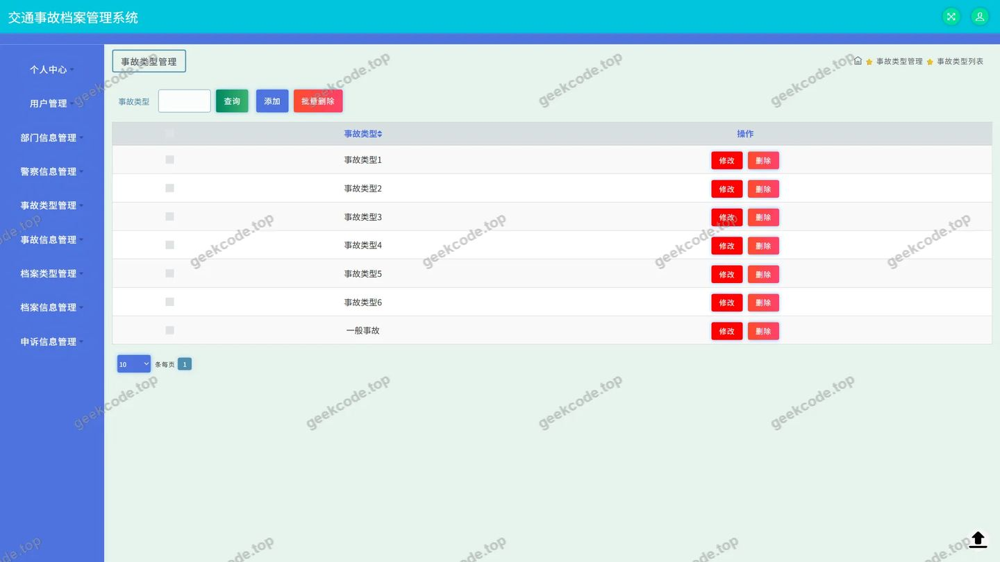
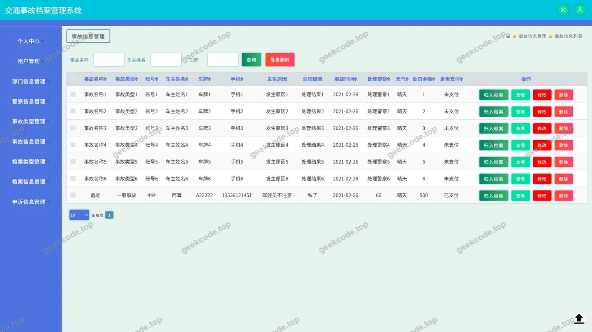
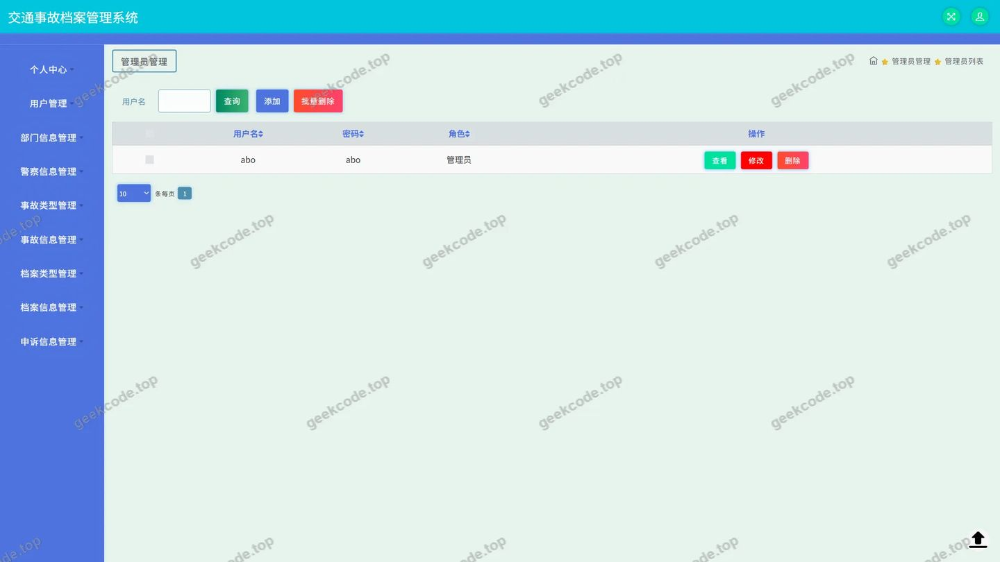

# 交通档案管理系统

> 🎓 **计算机毕业设计 · 交通档案管理系统**
>
> 本仓库只放**项目介绍 + 运行截图**（截图是站点带水印的原图，存在仓库 `images/` 里）。
>
> 👉 **完整可运行源码 / 数据库脚本 / 部署文档：[点我获取](https://geekcode.top/archives/%E4%BA%A4%E9%80%9A%E6%A1%A3%E6%A1%88%E7%AE%A1%E7%90%86%E7%B3%BB%E7%BB%9F?utm_source=github)**
>
> 💬 咨询微信：**ir9372**　|　🌐 更多项目：[极客代码 geekcode.top](https://geekcode.top/?utm_source=github)
>
> 📌 项目详情页：<https://geekcode.top/archives/%E4%BA%A4%E9%80%9A%E6%A1%A3%E6%A1%88%E7%AE%A1%E7%90%86%E7%B3%BB%E7%BB%9F?utm_source=github>

<table><td width="230" align="center"> <b>扫码加微信 ir9372</b></td><td valign="middle">📦 源码 = 项目介绍 + 全部运行截图 + 数据库 + 部署文档 👉 点上方任意截图，直接跳到 <b>极客代码 geekcode.top</b> 详情页</td></table>

---

<h1>交通档案管理系统</h1>
<h2>项目概述</h2>

交通档案管理系统是一款基于 Java 技术栈构建的后端服务系统，旨在实现交通领域基础数据的数字化管理与维护。该系统采用纯 API 架构设计，不包含独立的前台展示页面或后台管理界面，主要面向具备前端开发能力的集成方提供数据接口支持。核心功能涵盖部门信息管理、档案类型与详情维护、警察信息登记、事故类型及记录处理、申诉信息管理以及用户权限体系等模块。通过标准化的 RESTful 接口输出，系统能够高效处理交通相关档案的增删改查业务逻辑，适用于需要对接第三方前端应用或移动端应用的场景，为交通执法与档案管理提供稳定、安全的数据底层支撑。

<h2>技术架构</h2>

本项目采用分层架构设计，基于 Spring Boot 框架进行快速开发与配置，利用 MyBatis-Plus 作为持久层框架以简化数据库操作并提升开发效率，同时集成 Druid 连接池以确保数据库访问的高性能与稳定性。

<strong>后端架构：</strong>
系统后端由 Controller 层、Service 层（隐含）和 Mapper 层组成。Controller 层负责接收 HTTP 请求并进行参数校验，调用业务逻辑处理数据；MyBatis-Plus 提供了通用的 CRUD 方法，减少了样板代码；Druid 监控数据库连接状态，优化资源复用。

<strong>核心技术选型理由：</strong>

<ol>
<li><strong>Spring Boot</strong>: 提供自动配置和内嵌服务器，降低部署复杂度，适合快速构建微服务或单体后端。</li>
<li><strong>MyBatis-Plus</strong>: 在 MyBatis 基础上增强，支持条件构造器和分页插件，极大提升了复杂查询的开发效率。</li>
<li><strong>Druid</strong>: 阿里开源的高性能数据库连接池，具备强大的监控和扩展功能，保障系统在高并发下的稳定性。</li>
</ol>

<strong>数据交互：</strong>
系统仅暴露 API 接口，所有数据交互均通过 JSON 格式进行，遵循前后端分离原则，便于多端适配。

<h2>功能模块</h2>

由于该项目为纯 API 后端系统，无内置 UI 界面，以下模块指代其提供的核心业务接口能力：

<h3>基础数据管理模块</h3>
<ul>
<li><strong>部门信息管理 (<code>BumenxinxiController</code>)</strong>: 提供交通管理部门信息的录入、修改、删除及查询接口，用于组织架构维护。</li>
<li><strong>用户管理 (<code>UserController</code>, <code>YonghuController</code>)</strong>: 包含系统用户的注册、登录验证、信息更新及权限状态管理接口，支撑系统的身份认证基础。</li>
</ul>
<h3>档案业务管理模块</h3>
<ul>
<li><strong>档案类型管理 (<code>DanganleixingController</code>)</strong>: 定义和维护交通档案的分类标准，如违章档案、事故档案等类别的配置。</li>
<li><strong>档案信息管理 (<code>DanganxinxiController</code>)</strong>: 处理具体档案记录的存储与检索，关联部门、人员及事件详情，是系统的核心数据存储单元。</li>
</ul>
<h3>警务与事故处理模块</h3>
<ul>
<li><strong>警察信息管理 (<code>JingchaxinxiController</code>)</strong>: 维护执法人员的基本资料、警号、所属部门等信息，确保执法主体可追溯。</li>
<li><strong>事故类型管理 (<code>ShiguleixingController</code>)</strong>: 对交通事故进行分类编码管理，如轻微事故、重大事故等，便于数据统计分析。</li>
<li><strong>事故信息管理 (<code>ShiguxinxiController</code>)</strong>: 记录交通事故的详细情况，包括时间、地点、涉事车辆及人员、责任认定等关键数据。</li>
</ul>
<h3>申诉与服务模块</h3>
<ul>
<li><strong>申诉信息管理 (<code>ShensuxinxiController</code>)</strong>: 处理用户对处罚或事故认定的申诉请求，记录申诉理由、处理进度及最终结果。</li>
<li><strong>通用服务 (<code>CommonController</code>, <code>ConfigController</code>, <code>FileController</code>)</strong>: 提供文件上传下载、系统全局配置读取及通用字典数据获取等辅助功能。</li>
</ul>
<h2>用户角色与权限</h2>

根据现有代码上下文中的 Controller 列表及系统性质，本系统作为后端 API 服务，其权限控制主要通过 Token 或 Session 机制在接口层实施。虽然未直接展示前端路由菜单，但依据典型交通档案系统的业务逻辑及控制器命名，可推断出以下角色权限模型：

<table>
<thead>
<tr>
<th align="left">角色名称</th>
<th align="left">权限描述</th>
<th align="left">可访问功能模块</th>
</tr>
</thead>
<tbody><tr>
<td align="left"><strong>超级管理员</strong></td>
<td align="left">拥有系统最高权限，负责系统初始化、用户管理及全局配置。</td>
<td align="left">1. 用户管理2. 部门信息管理3. 档案类型管理4. 事故类型管理5. 系统配置管理6. 文件管理</td>
</tr>
<tr>
<td align="left"><strong>档案管理员</strong></td>
<td align="left">负责交通档案的日常录入、审核与维护，侧重于数据完整性。</td>
<td align="left">1. 档案信息管理2. 档案类型查看3. 警察信息查看4. 申诉信息管理（审核/回复）5. 文件上传/下载</td>
</tr>
<tr>
<td align="left"><strong>警务人员</strong></td>
<td align="left">一线执法人员，主要负责事故现场数据上报及个人信息查询。</td>
<td align="left">1. 事故信息管理（新增/编辑本人经手案件）2. 警察信息（查看/更新个人部分信息）3. 档案信息（查询相关记录）4. 申诉信息（提交初步材料）</td>
</tr>
<tr>
<td align="left"><strong>普通用户</strong></td>
<td align="left">系统外部使用者或受限内部人员，通常仅具备查询权限。</td>
<td align="left">1. 档案信息（仅查询公开或部分脱敏数据）2. 申诉信息（发起申诉、查询进度）3. 个人信息管理</td>
</tr>
</tbody></table>

<em>注：具体权限粒度取决于 <code>CommonController</code> 和 <code>ConfigController</code> 中实现的拦截器策略，上述分类基于标准 RBAC（基于角色的访问控制）模型推导。</em>

<h2>项目特色与创新点</h2>
<ol>
<li>
<strong>高度解耦的 API 优先架构</strong>：
   项目严格遵循“纯 API”设计模式，彻底剥离了视图层逻辑。这种架构使得后端服务可以无缝对接 Web 端、移动 App、微信小程序等多种前端载体，极大地提升了系统的灵活性和可扩展性。

</li>
<li>
<strong>标准化数据模型驱动</strong>：
   通过 <code>DanganleixingController</code> 和 <code>ShiguleixingController</code> 等模块，建立了严格的档案与事故分类标准。这种元数据管理方式确保了交通数据的一致性和规范性，为后续的大数据分析奠定了坚实基础。

</li>
<li>
<strong>高效的持久层封装</strong>：
   利用 MyBatis-Plus 的特性，实现了复杂查询条件的动态构建与自动化 SQL 生成。结合 Druid 连接池的智能监控，系统在保持代码简洁的同时，显著降低了数据库层面的运维成本和安全风险。

</li>
<li>
<strong>全流程闭环管理支持</strong>：
   从警察信息录入、事故发生登记、档案归档到最终的申诉处理，系统覆盖了交通执法的全生命周期。特别是 <code>ShensuxinxiController</code> 的存在，体现了系统对行政相对人权益保护的重视，完善了执法监督机制。

</li>
</ol>
<h2>部署环境</h2>

为确保交通档案管理系统正常运行，需准备以下软件环境：

<ul>
<li><strong>操作系统</strong>: Linux (CentOS 7+, Ubuntu 18.04+) 或 Windows Server 2016+。</li>
<li><strong>Java 运行环境</strong>: JDK 1.8 或更高版本（推荐 JDK 8 LTS）。</li>
<li><strong>数据库</strong>: MySQL 5.7 或 MySQL 8.0，需启用 UTF-8MB4 字符集以支持中文存储。</li>
<li><strong>构建工具</strong>: Maven 3.6+，用于依赖管理和项目打包。</li>
<li><strong>其他组件</strong>: </li>
<li>无需安装 Node.js 或微信开发者工具，因为该项目不包含前端代码编译需求。</li>
<li>若使用 Docker 部署，需安装 Docker Engine 19.03+ 及 Docker Compose。</li>
</ul>

<strong>启动步骤简述：</strong>

<ol>
<li>配置 <code>application.yml</code> 中的数据库连接 URL、用户名和密码。</li>
<li>执行 Maven 命令 <code>mvn clean package</code> 生成 JAR 包。</li>
<li>使用命令 <code>java -jar target/traffic-archive-system.jar</code> 启动服务。</li>
</ol>
<h2>五、技术特性</h2>
<ul>
<li>使用 MyBatis-Plus 简化数据访问层开发</li>
</ul>
<h2>六、功能模块截图</h2>
<h3>后台管理端</h3>
<h4>页面-部门信息</h4>

<h4>页面-档案类型</h4>

<h4>页面-档案信息</h4>

<h4>页面-登录</h4>

<h4>页面-警察信息</h4>

<h4>页面-申诉信息</h4>

<h4>页面-事故类型</h4>

<h4>页面-事故信息</h4>

<h4>页面-用户</h4>

---

## 获取完整源码

| 项目 | 说明 |
| --- | --- |
| 项目名 | 交通档案管理系统 |
| 运行截图 | 本文 9 张（站点带水印原图，仓库 `images/` 目录） |
| 完整源码 | [https://geekcode.top/archives/%E4%BA%A4%E9%80%9A%E6%A1%A3%E6%A1%88%E7%AE%A1%E7%90%86%E7%B3%BB%E7%BB%9F?utm_source=github](https://geekcode.top/archives/%E4%BA%A4%E9%80%9A%E6%A1%A3%E6%A1%88%E7%AE%A1%E7%90%86%E7%B3%BB%E7%BB%9F?utm_source=github) |
| 咨询微信 | **ir9372**（备注：jingpin-yuanma） |
| 更多项目 | [极客代码 geekcode.top](https://geekcode.top/?utm_source=github) |

> 需要源码、部署、改配置、跑不起来等问题，加微信 ir9372 沟通，说明项目名即可。
